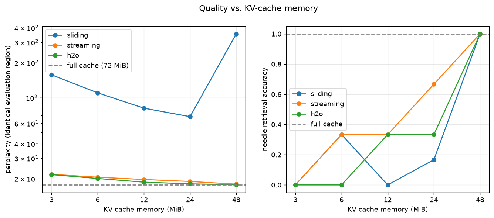

# KV Cache Eviction Study: Attention Sinks vs. Heavy Hitters

How much of a transformer's KV cache can you throw away, and which entries
should you keep? This project runs that experiment on a real model
(**Qwen2.5-0.5B-Instruct**). It uses a hand-written Qwen2 forward pass whose cache
you can inspect, and it measures attention patterns, perplexity, needle-in-a-haystack
retrieval, positional (RoPE) handling and decode speed.

It compares three bounded-cache policies:

| Policy | Keeps | Based on |
|---|---|---|
| **Sliding window** | the newest *B* tokens | naive baseline |
| **Sink-aware** | the first 4 tokens plus the newest *B − 4* | [StreamingLLM](https://arxiv.org/abs/2309.17453) |
| **Heavy-hitter** | the recent half plus the keys with the most accumulated attention, chosen per KV head | [H2O](https://arxiv.org/abs/2306.14048) |



## Key findings

All numbers are FP32 on an Apple GPU. Full tables are in [`results/REPORT.md`](results/REPORT.md).

- **Attention sinks exist, and they don't depend on content.** On natural text, 30.5%
  of attention mass lands on the first four tokens, compared with 0.70% under causal
  uniform attention. The effect remains with random token IDs (29.8%) and with a
  replaced prefix (30.4%). Token 0 receives 174× its uniform share.
- **Losing the sinks is what breaks the sliding window, not the small budget.**
  The full cache gives 17.69 PPL. At *B* = 128 (3 MiB instead of 72 MiB), sink-aware
  scores 21.83 and heavy-hitter 21.70. Sliding window scores 157.4.
- **Heavy-hitter has the best perplexity but not the best recall.** H2O has the lowest
  PPL at every budget. However, at *B* = 1024 it retrieves 2/6 passkeys against 4/6 for
  sink-aware. It evicts a needle before any query has attended to it.
- **RoPE positions must be handled consistently.** Two modes keep positions
  consistent: recompute and absolute. They reach 16.70 and 16.71 PPL with 6/6
  retrieval. A deliberately "stale" implementation collapses to 275.0 PPL and 0/6
  retrieval, even though the same needles are verified to remain in the cache.
- **Compression also speeds up decoding.** At 4,096 tokens, bounded caches decode at
  0.28–0.53× the full-cache time per token. This comes from one noisy run.

| Budget | KV MiB | Sliding | Sink-aware | Heavy-hitter |
|---:|---:|---:|---:|---:|
| Full | 72.0 | 17.69 / 100% | — | — |
| 128 | 3.0 | 157.43 / 0% | 21.83 / 0% | **21.70** / 0% |
| 512 | 12.0 | 81.19 / 0% | 19.70 / 33% | **18.68** / 33% |
| 1024 | 24.0 | 68.59 / 17% | 18.94 / **67%** | **18.06** / 33% |

*Cells show perplexity / passkey retrieval accuracy. Retrieval uses 6 correlated
trials per cell, so read it as a direction, not a precise rate.*

The [write-up](WRITEUP.md) covers the methodology and controls. It also explains why
sinks form, and gives recommendations for multi-turn agents and long-document
summarizers.

## What's inside

```
kvcache/
  model.py       Manual Qwen2 forward pass that reuses HF weights and exposes attention probabilities
  cache.py       Inspectable per-layer K/V cache with original positions and accumulated scores
  policies.py    Sliding, StreamingLLM and H2O eviction policies
  streaming.py   Bounded runner that evicts before attention, so the cache never exceeds the budget
  rope.py        RoPE helpers for the recompute, absolute and stale position modes
scripts/
  instrument_attention.py   Sink mass, 90%-coverage and entropy for each layer and head, with controls
  eval_ppl.py / eval_niah.py   Long-document perplexity and passkey retrieval
  run_curve.py              Sweep of quality against memory
  rope_ablation.py          Position-mode ablation with verified needle retention
  benchmark.py              Decode latency and KV memory
  report.py                 Builds results/REPORT.md and the plots from saved JSON
tests/            Logits match HF exactly, plus checks on cache bounds, RoPE identities and policy indices
results/, plots/  Every measured output, including per-trial answers and per-head retention
```

## Quick start

Tested with Python 3.11. You don't need training, an API key or a paid service.

```bash
python3.11 -m venv .venv && source .venv/bin/activate
pip install -r requirements.txt
python data/get_data.py   # Pride and Prejudice + Frankenstein from Project Gutenberg

# Download the model once (later runs work offline)
python -c 'from huggingface_hub import snapshot_download; snapshot_download("Qwen/Qwen2.5-0.5B-Instruct")'

# Fast tests: tiny random weights, no model download needed
python -m pytest -q

# Full measured suite (use DEVICE=cpu or DEVICE=cuda off Apple silicon)
DEVICE=mps bash run_all.sh
```

Individual experiments:

```bash
python -m scripts.instrument_attention --n_tokens 2048
python -m scripts.eval_ppl   --policy streaming --budget 512
python -m scripts.eval_niah  --policy h2o --budget 512 --ctx 2048
python -m scripts.rope_ablation --policy streaming --budget 512 --ctx 2048
python -m scripts.run_curve --texts data/pride_and_prejudice.txt,data/frankenstein.txt \
    --budgets 128,256,512,1024,2048 --n_tokens 3072 --ctx 2048
```

If a long run fails, resume it with
`python -m scripts.complete --stages attention,curve,rope,benchmark --device mps`.
Then rebuild the report with `python -m scripts.report`.

## Design notes

- **Exact budget.** Each incoming block's space is reserved *before* attention, so
  no layer's cache ever holds more than *B* entries. The default eviction block is
  32 tokens. Set `chunk_size=1` for fully online eviction.
- **Per-head selection.** H2O sums scores across the query heads that share a KV
  head (GQA). Each KV head in each layer then keeps its own set of entries.
- **Position modes.** In `recompute` mode, keys are stored before RoPE and rotated
  at compacted positions (StreamingLLM-style). `absolute` keeps the original
  positions, including the gaps left by eviction. `stale` exists only as a negative
  control.
- **Per-layer budgets.** Pass a list such as
  `StreamingRunner(model, make_policy("h2o"), layer_budgets=[...])`.
- **Memory accounting.** Reported KV bytes count K and V only (24 KiB per token in
  FP32). Position and score metadata are reported separately.

## Limitations

This is research code: batch size 1, Qwen2 models with standard RoPE only, eager
attention, and a block-level eviction approximation. It is not a serving engine.
FP32 is the validated precision. FP16 failed a positional tolerance check, so it
was excluded from the results. The retrieval benchmark uses repeated filler and a
small number of keys. [WRITEUP.md](WRITEUP.md#limits-and-future-work) describes
these limits in full.

## References

- Xiao et al., *Efficient Streaming Language Models with Attention Sinks* (2023). [arXiv:2309.17453](https://arxiv.org/abs/2309.17453)
- Zhang et al., *H2O: Heavy-Hitter Oracle for Efficient Generative Inference of LLMs* (2023). [arXiv:2306.14048](https://arxiv.org/abs/2306.14048)
- [mit-han-lab/streaming-llm](https://github.com/mit-han-lab/streaming-llm)
